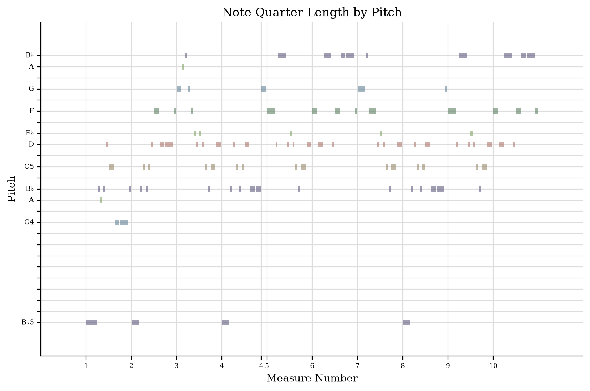
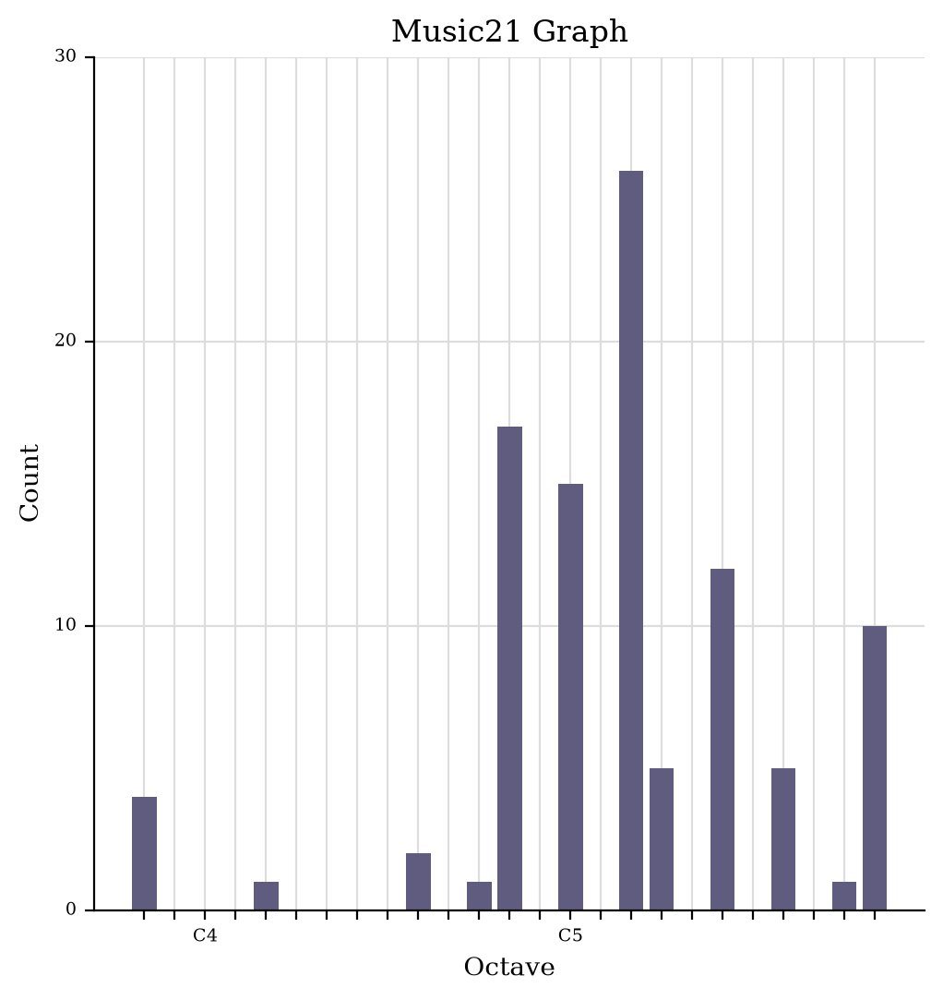
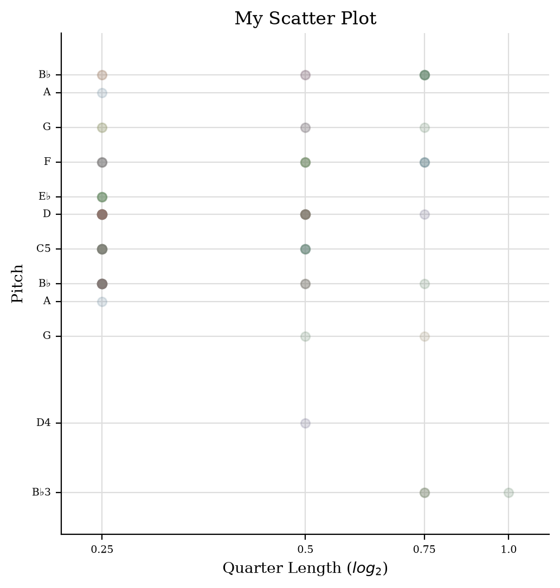

# \[Lab Tasks\]
<!-- Version 1.0 -->

## Week 1

### Theme: Niel Gow and the Gow family’s printed fiddle music
  https://www.hms.scot/prints/copy/8/

### My own reflection regarding challenges to working with music and music-related data:

  ### Challenges of working with music data
Most of my own engagement with music comes through DJing and producing house music, which makes the problem of "music data" very visible. A modern dance track can't truly be accurately represented by a score. The raw data exists as an audio file exported from popular music production software like FL Studio or Ableton. Key information like credits, tempo and key is spread across streaming platforms or DJ software. Additionally details across these platforms are often incomplete or inconsistent. Yet, the Main challenges I have observed with working with music data are the following; 
- The first is access in the sense that a lot of music is restricted by copyright, paywalls or rare physical formats
- The second is curation and the way that decisions are made around what gets collected and how it is described.
- The third is representation, which is what I was trying to capture in my example of dance music, there is no single format whether that be score, recording or metadata, which captures a piece of music completely.

### How my theme displays these challenges
My theme is Niel Gow's printed fiddle music, centred on the online copy of the *First Book of Niel Gow's Reels* found on HMS.Scot. 

- **Authorship:** Although the book is published under Gow's name, it includes tunes by his family and friends, as well as pieces described only as "a very old tune". 
- **Notation versus practice:** Ultimately, as with all sheet music, the printed score is partly a commercial product for a domestic market of musicians and therefore not a straightforward record of how Gow played.

### Current curation and presentation
The main source for my theme is Historical Music of Scotland (HMS, HMS.Scot), a project that catalogues printed sources of Scottish fiddle music from the 1800s. The *First Book of Niel Gow's Reels* is presented as digitised page scans of a physical copy alongside a full tune list. HMS even describes the physical copy itself under the 'Copy Notes', noting that it is yellowed and signed by a previous owner, "Capt Simpson". Recordings of Gow's tunes, by contrast, are found separately on sites like Youtube and the Traditional Tune Archive platforms.

### Strengths and weaknesses
The scores that HMS uses are mainly photographs of pages, rather than machine-readable data, it is designed for specialists, and it doesn't link to recordings. In direct comparison, streaming platforms make the music easy to hear, but their metadata is commercial and says little about the historical source. Overall, the data for my theme is split across systems that don't connect to each other which poses a fair challenge. 

## Week 2: Niel Gow's Farewell to Whisky Transcription

### What the OMR engine got wrong
- **Mishandled the file:** Audiveris refused the PDF of the page I downloaded from HMS.Scot outright. The PDF was too big for Audiveris to handle it seemed so I had to crop the page to a just "Farewell to Whisky" as opposed to the full page which included another tune above it.
- **Structure:** it split one piece into two separate files when i went to export.
- **Text:** the title and caption were mangled. "Compofed for this 2d Edition" became "Ccmpoffd for thiS' Edition" and "Whisky" disappeared completely.
- **Key signature:** Audiveris only picked up one of the two flats in the key signature.

## Week 3: Verovio conversion and comparison between .MusicXML vs .Mei

- **Please see the following link:**(https://jamesf21dmis.github.io/MCA-2026/verovio.html)

## Week 4: music21 analysis

Firstly, I exported my transcription of Farewell to Whisky from MuseScore as a MIDI file, and then ran it through jSymbolic with the following boxes ticked: Range, Mean Pitch, Most Common Pitch Class, Last Pitch, and Most Common Rhythmic Value

[jSymbolic feature values (CSV)](data/jsymbolic-features.csv.csv)

Secondly I followed the music21 instructions and managed to extract a piano roll, pitch histogram, and a scatter plot of pitches:

## Week 5: Metadata and MEI Encoding 

### Chosen Metadata

- Title i.e. "Farewell to Whisky"
- Artist i.e. "Niel Gow"
- Publisher i.e. "Gow & Son's"
- Date i.e. "1801"
- Key i.e. "B♭ Major"

### Updated MEI File
(data/FarewelltoWhiskyMuseScore.mei)

### Reflection: 

The way I chose my five elements was by trying to hone in on considering who would use a catalogue of Gow's fiddle music. For example, Title and artist are basics that anyone would search by, however publisher and date matter more to historians that would be interested in how Scottish fiddle music was printed and distributed around 1800. Key is also useful to musicians that would look to replicate the piece. 

I also linked Niel Gow as an artist to his VIAF record using '@auth' and '@auth.uri'. I got this idea from the lecture slides as VIAF was listed as a common authority for people, so i followed the format of the lecture's example. I also think using an authority here is important as the name is often spelled as "Neil", in addition to there being multiple people named Niel Gow. I then added his life dates; 'startdate="1727" enddate="1807"' and checked them against the VIAF record so i was certain that it linked to the right person

Additionally, when looking at the lecture example, i noticed the composer was placed inside '<respStmt>', so i decided to just replicate this approach despite the MEI sample file I looked at using a '<composer>' element instead as I wanted to just align myself with the course's approach. Additionally, I put the key in '<worklist>', which describes the piece as a musical work. I then consulted HMS to find the publisher, "Gow & Son's"

### Sources Consulted

- Duguid, T., Lecture 6: "Description Best Practice", Music Curation and Analytics 26/27, University of Glasgow
- MEI Sample Encodings, *Aguado_Walzer_G-major.mei* (MEI 5.0): https://github.com/music-encoding/sample-encodings/tree/main/MEI_5.0/Music/Complete_examples
- Historical Music of Scotland, *First Book of Niel Gow's Reels*, 2nd edition (1801), Glasgow University Library Ca11-y.30: https://www.hms.scot/prints/copy/8/
-  VIAF, Gow, Niel, 1727–1807: https://viaf.org/viaf/183286907
-  Music Encoding Initiative, *MEI Guidelines v5*: https://music-encoding.org/guidelines/v5/content/index.html
