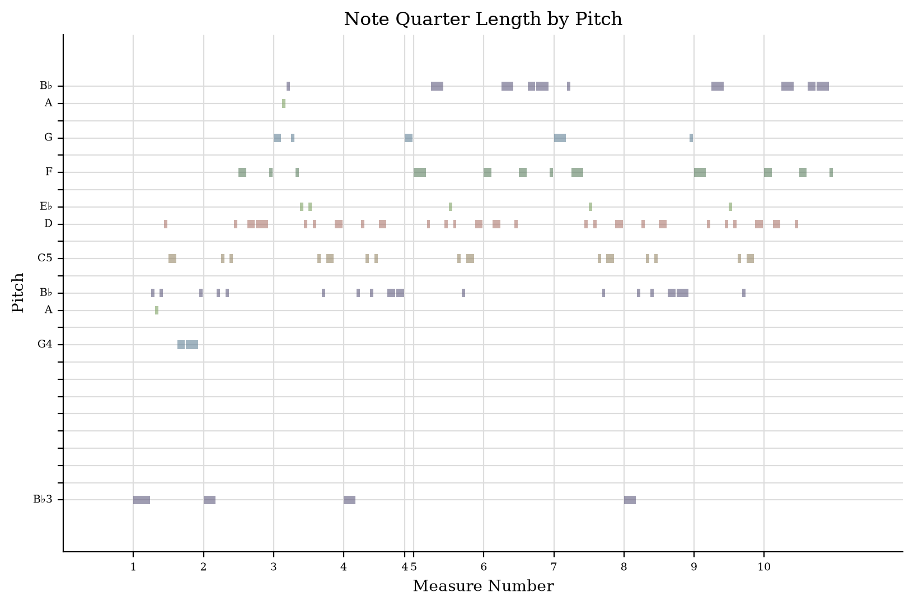
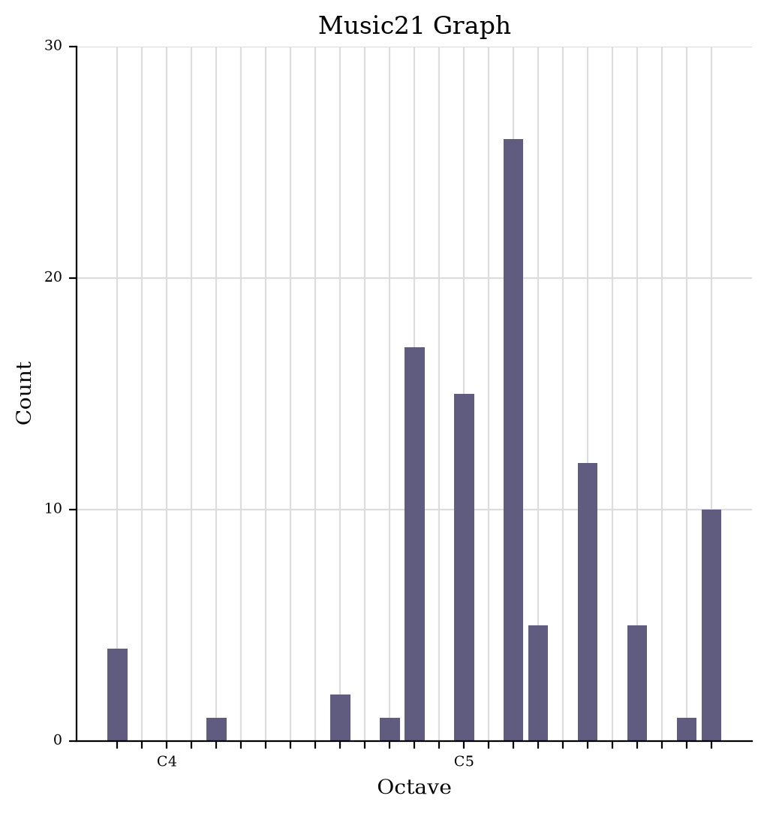

# \[Lab Tasks\]
<!-- Version 1.0 -->

## Week 1

### Theme: Niel Gow and the Gow family’s printed fiddle music
  https://www.hms.scot/prints/copy/8/

### My own reflection regarding challenges to working with music and music-related data:

  ### Challenges of working with music data
Most of my own engagement with music comes through DJing and producing house music, which makes the problem of "music data" very visible. A modern dance track can't truly be accurately represented by a score. The raw data exists as an audio file exported from popular music production software like FL Studio or Ableton. Key information like credits, tempo and key is spread across streaming platforms or DJ software. Additionally details across these platforms are often incomplete or inconsistent. Yet, the Main challenges I have observed with working with music data are the following; 
- The first is access in the sense that a lot of music is restricted by copyright, paywalls or rare physical formats
- The second is curation and the way that decisions are made around what gets collected and how it is described.
- The third is representation, which is what I was trying to capture in my example of dance music, there is no single format whether that be score, recording or metadata, which captures a piece of music completely.

### How my theme displays these challenges
My theme is Niel Gow's printed fiddle music, centred on the online copy of the *First Book of Niel Gow's Reels* found on HMS.Scot. 

- **Authorship:** Although the book is published under Gow's name, it includes tunes by his family and friends, as well as pieces described only as "a very old tune". 
- **Notation versus practice:** Ultimately, as with all sheet music, the printed score is partly a commercial product for a domestic market of musicians and therefore not a straightforward record of how Gow played.

### Current curation and presentation
The main source for my theme is Historical Music of Scotland (HMS, HMS.Scot), a project that catalogues printed sources of Scottish fiddle music from the 1800s. The *First Book of Niel Gow's Reels* is presented as digitised page scans of a physical copy alongside a full tune list. HMS even describes the physical copy itself under the 'Copy Notes', noting that it is yellowed and signed by a previous owner, "Capt Simpson". Recordings of Gow's tunes, by contrast, are found separately on sites like Youtube and the Traditional Tune Archive platforms.

### Strengths and weaknesses
The scores that HMS uses are mainly photographs of pages, rather than machine-readable data, it is designed for specialists, and it doesn't link to recordings. In direct comparison, streaming platforms make the music easy to hear, but their metadata is commercial and says little about the historical source. Overall, the data for my theme is split across systems that don't connect to each other which poses a fair challenge. 

## Week 2: Niel Gow's Farewell to Whisky Transcription

### What the OMR engine got wrong
- **Mishandled the file:** Audiveris refused the PDF of the page I downloaded from HMS.Scot outright. The PDF was too big for Audiveris to handle it seemed so I had to crop the page to a just "Farewell to Whisky" as opposed to the full page which included another tune above it.
- **Structure:** it split one piece into two separate files when i went to export.
- **Text:** the title and caption were mangled. "Compofed for this 2d Edition" became "Ccmpoffd for thiS' Edition" and "Whisky" disappeared completely.
- **Key signature:** Audiveris only picked up one of the two flats in the key signature.

## Week 3: Verovio conversion and comparison between .MusicXML vs .Mei

- **Please see the following link:**(https://jamesf21dmis.github.io/MCA-2026/verovio.html)

## Week 4: music21 analysis

Firstly, I ran my transcription of Farewell to Whisky from MuseScore as a MIDI file, and then ran it through jSymbolic with the following boxes ticked: Range, Mean Pitch, Most Common Pitch Class, Last Pitch, and Most Common Rhythmic Value

[jSymbolic feature values (CSV)](data/jsymbolic-features.csv)

Secondly I followed the music21 instructions and managed to extract a piano roll, pitch histogram, and a scatter plot of pitches:

